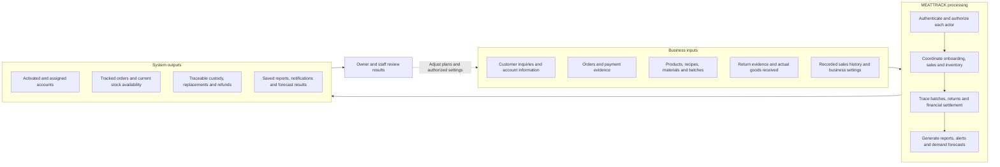
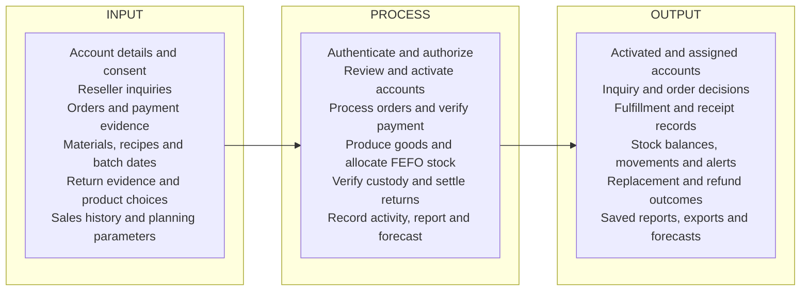
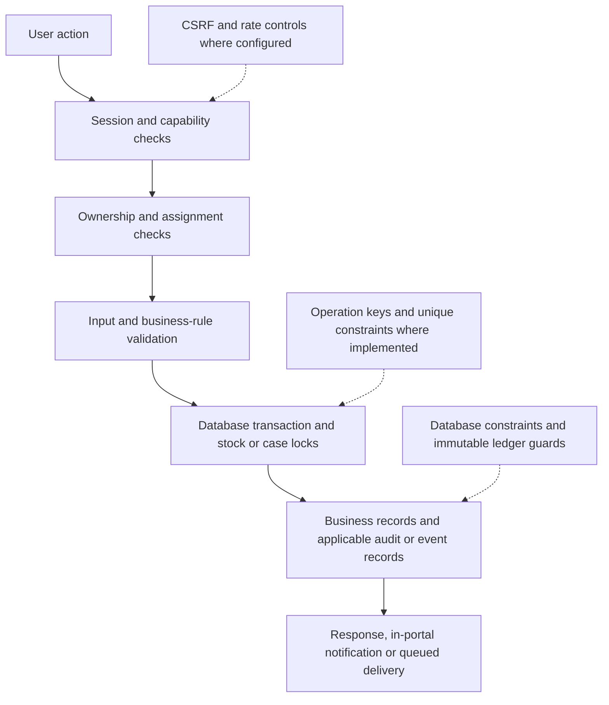

# MEATTRACK conceptual framework and IPO

Source review: **2026-10-31**, current local working tree, including migrations through **044**. These diagrams describe implemented software responsibilities; they do not establish the production server's deployed revision or measure business improvements.

## Conceptual framework

MEATTRACK connects business records, controlled transactions, and management information. The feedback arrow represents human planning and operational decisions; forecasts do not automatically create production orders or purchase materials.

The intended contribution is coordinated ordering, inventory traceability, after-sales handling, and decision support. Claims such as reduced spoilage, improved forecast accuracy, or faster processing require separate evaluation data and are not established by source inspection.

## Input-process-output model

| Input category | Main process | Concrete output |
| --- | --- | --- |
| Identity and consent | Password validation, optional login OTP, database session, capability and ownership checks | Authenticated role-scoped session and consent history |
| Prospective reseller details | Validate inquiry, assign Supervisor, review and provision | Inquiry decision, reseller profile, portal account, activation email queue |
| Selected products and payment evidence | Calculate server prices, recognize receipt details, validate payment, reserve available stock, review and fulfill | Order, proof records, reservations, batch allocations and system messages |
| Materials, recipes and production quantities | Validate units, lock material balances, consume recipe requirements and create batch | Material deductions, finished batch, immutable movement records |
| Return selections and supporting photos | Validate 120-hour window, trace original allocations, review, receive complete goods and settle | Non-sellable custody, refund or replacement records, event history |
| Personally handled order activity and report dates | Build consistent preview, revalidate and freeze submission | Orders, Sales, Returns and Refunds document; CSV, Excel and print views |
| Fulfilled-sales history, usable stock and forecast horizon | Queue worker job, compare eligible models, store diagnostics and results | Daily demand estimates, uncertainty where available and production gap |

## Cross-cutting controls

## Source basis

- Application assembly: [`app/application.py`](../../app/application.py).
- Identity and scope: [`app/routers/auth.py`](../../app/routers/auth.py), [`app/capabilities.py`](../../app/capabilities.py), [`app/portal_dependencies.py`](../../app/portal_dependencies.py).
- Business processing: [`app/repositories/orders.py`](../../app/repositories/orders.py), [`app/repositories/inventory/`](../../app/repositories/inventory/), [`app/repositories/product_returns.py`](../../app/repositories/product_returns.py), [`app/repositories/replacement_workflow.py`](../../app/repositories/replacement_workflow.py), [`app/repositories/refunds.py`](../../app/repositories/refunds.py).
- Information outputs: [`app/repositories/activity_reports.py`](../../app/repositories/activity_reports.py), [`app/forecasting.py`](../../app/forecasting.py), [`app/worker.py`](../../app/worker.py).
