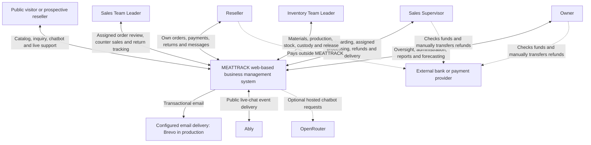
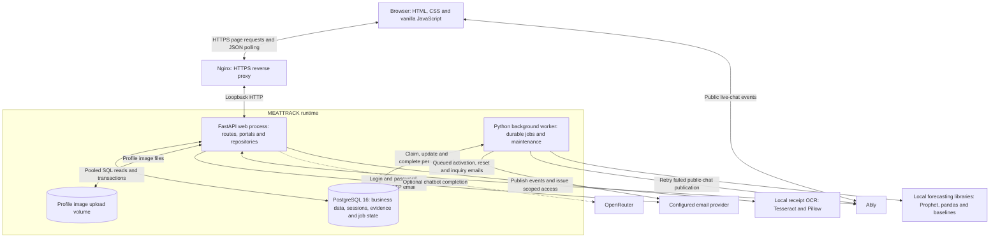
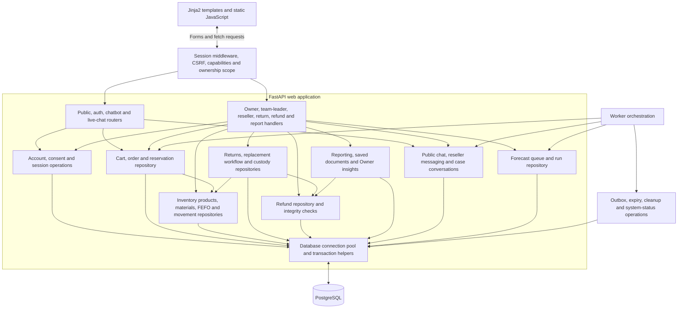
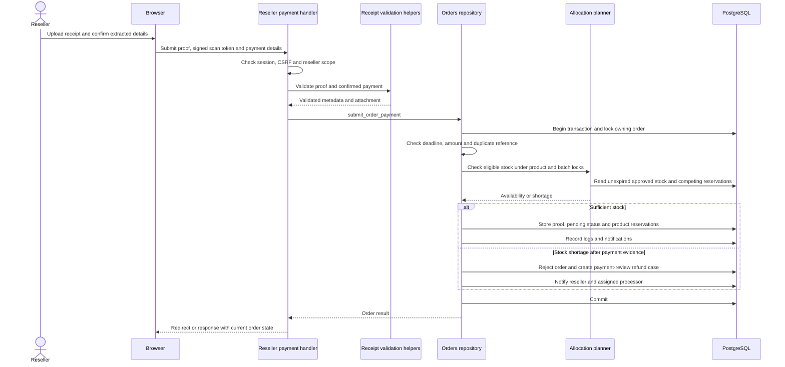
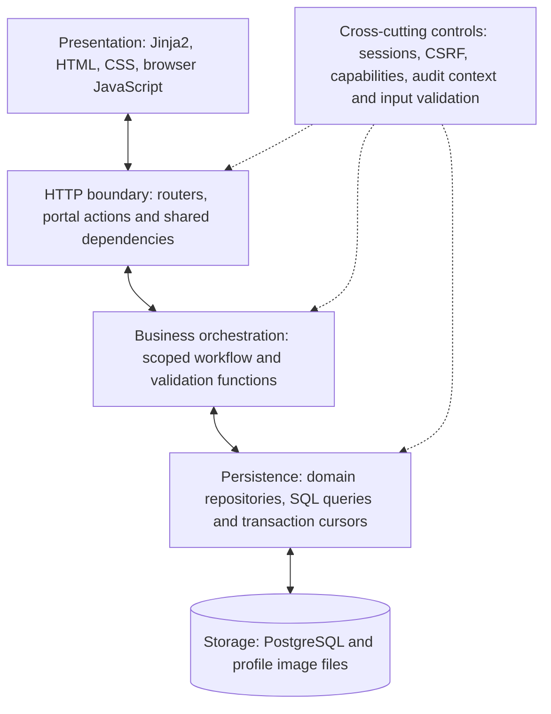
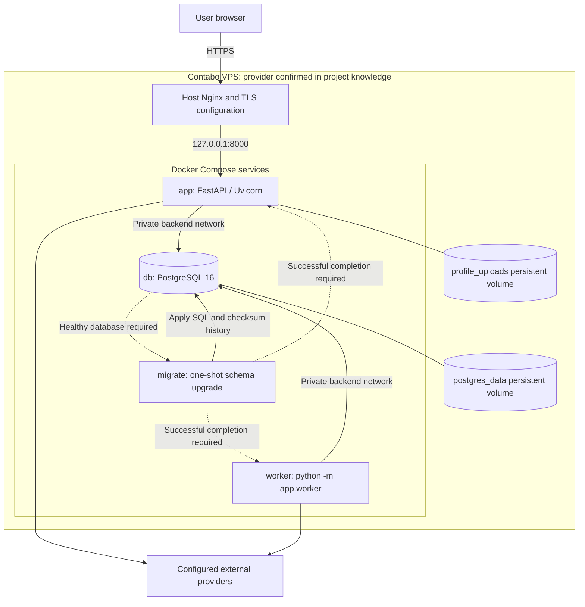

# MEATTRACK system architecture at different levels

Source review: **2026-10-31**. Levels 1-3 follow the context, container and component ideas of C4, expressed using ordinary Mermaid flowcharts. The logical layers and deployment views complement those levels. A module box is a responsibility inside the application, not a separately deployed service.

## Level 1: system context

Payment-provider activity is a human operational dependency. The inspected code records proof and confirmations; it does not integrate an automatic payment gateway or execute bank transfers.

## Level 2: runtime containers

The application and worker use the same repository code and database. PostgreSQL provides the durable queues; no Redis, Celery broker, or independently deployed forecasting API is represented by the current implementation. Payment proof, return evidence, refund proof, report attachments and internal conversation media are database-backed; profile pictures use the upload volume.

## Level 3: web and worker components

Arrows summarize calls and data access; they are not an exhaustive Python import graph. `app/repositories/__init__.py` re-exports domain functions as a compatibility facade.

## Level 4: representative transaction detail

This view expands one important operation rather than presenting every Python function as an architecture box. Related rejection and refund branches appear in the module flowcharts.

## Logical layers and request path

This is a logical separation. Domain rules and persistence are often implemented together in repository functions rather than in a distinct service class layer.

## Deployment view from checked-in production configuration

This deployment diagram is a **configuration view**, not a live server inspection. The Compose backend network is private; the application binds to loopback for the host proxy. App and worker startup depend on a healthy database and successful migration completion.

## Source basis

[`app/main.py`](../../app/main.py), [`app/application.py`](../../app/application.py), [`app/database.py`](../../app/database.py), [`app/web_sessions.py`](../../app/web_sessions.py), [`app/worker.py`](../../app/worker.py), [`app/routers/`](../../app/routers/), [`app/portals/`](../../app/portals/), [`app/repositories/`](../../app/repositories/), [`app/receipt_ocr.py`](../../app/receipt_ocr.py), [`app/emailer.py`](../../app/emailer.py), [`compose.prod.yml`](../../compose.prod.yml), [`deploy/nginx/meattrack.conf`](../../deploy/nginx/meattrack.conf). Provider confirmation: [[Database and Operations]].
