# MEATTRACK module flowcharts

Source review: **2026-10-31**, current local working tree through migration **044**. Modules below are logical business responsibilities. Several share the same portal or repository; a screen is not necessarily a separate module. Unless shown otherwise, actions require valid session, capability, assignment/ownership and input checks; failed validation returns an error without committing the requested transaction.

## Module map

| ID | Module | Main actors | Main implementation |
| --- | --- | --- | --- |
| M01 | Authentication and access | All portal users | `app/routers/auth.py`, `app/web_sessions.py`, `app/capabilities.py` |
| M02 | Public catalog and chatbot | Visitor | `app/routers/public.py`, `app/routers/chatbot.py`, `app/chatbot/` |
| M03 | Inquiry review and reseller onboarding | Visitor, Supervisor, Owner | `app/repositories/inquiries.py`, `app/repositories/accounts.py` |
| M04 | Reseller cart, payment and order fulfillment | Reseller, assigned Sales, Owner | `app/portals/reseller.py`, `app/repositories/orders.py` |
| M05 | Counter sales | Sales, Supervisor | `app/portals/team_leader.py`, `app/repositories/orders.py` |
| M06 | Materials, product definitions and production | Inventory, Owner | `app/repositories/inventory/`, `app/inventory_measurements.py` |
| M07 | Expiry, pull-outs and disposal | Inventory, Owner, worker | `app/worker.py`, `app/repositories/product_returns.py` |
| M08 | Product returns and version-1 settlement | Reseller, Sales, Supervisor, Inventory, Owner | `app/repositories/product_returns.py`, `app/repositories/return_customer.py` |
| M09 | Version-2 replacement requests | Reseller, Supervisor, Inventory, Owner | `app/repositories/replacement_workflow.py`, `app/repositories/product_returns.py` |
| M10 | Manual money refunds | Supervisor, Owner, Reseller | `app/repositories/refunds.py`, `app/repositories/refund_integrity.py` |
| M11 | Sales activity reporting and exports | Sales, Supervisor, Owner | `app/repositories/activity_reports.py`, `app/portals/activity_reports.py`, `app/report_documents.py` |
| M12 | Demand forecasting | Owner, worker | `app/repositories/forecasts.py`, `app/forecasting.py` |
| M13 | Public live chat | Visitor, available Sales Team Leader | `app/live_chat.py`, `app/routers/live_chat.py` |
| M14 | Private conversations and unread state | Authorized conversation participants | `app/reseller_messaging.py`, `app/repositories/replacement_messages.py`, `app/conversation_notifications.py` |
| M15 | Owner administration and handover | Owner | `app/portals/owner.py`, `app/repositories/superuser.py`, `app/repositories/accounts.py` |
| M16 | Background jobs and notifications | Worker, notification recipients | `app/worker.py`, `app/repositories/notifications.py` |
| M17 | Dashboards and operational monitoring | Each authorized role | `app/repositories/portal_dashboard.py`, `app/repositories/owner_insights.py`, `app/repositories/reporting.py` |
| M18 | Profile and account recovery | Account holder, authorized administrator | `app/repositories/accounts.py`, `app/portals/shared.py`, `app/owner_recovery.py` |

The four role-oriented summaries at the end show how these modules fit together in daily use.

## M01 — Authentication and access

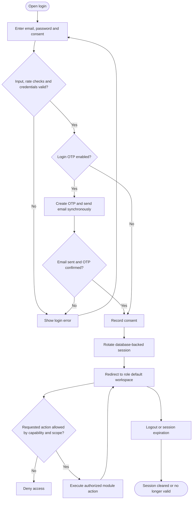

Accounts must satisfy the authentication repository's active/activation checks. Sales Supervisor is stored as a specialized `team_leader` role, not a fourth `account_type`. Owner actions do not currently require a separate emailed step-up code.

## M02 — Public catalog and chatbot

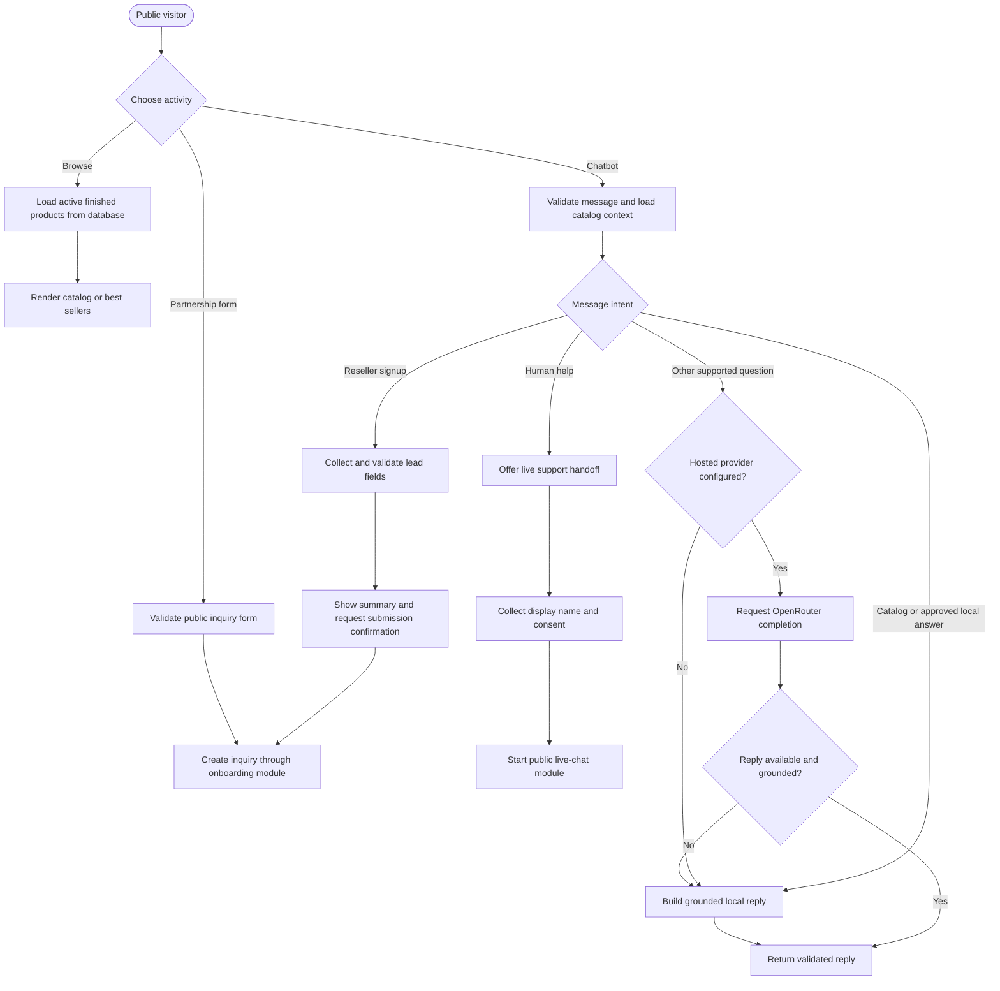

Sources: `app/routers/public.py`, `app/routers/chatbot.py`, `app/chatbot/lead_flow.py`, `app/chatbot/provider.py`, `app/chatbot/catalog.py`.

## M03 — Inquiry review and reseller onboarding

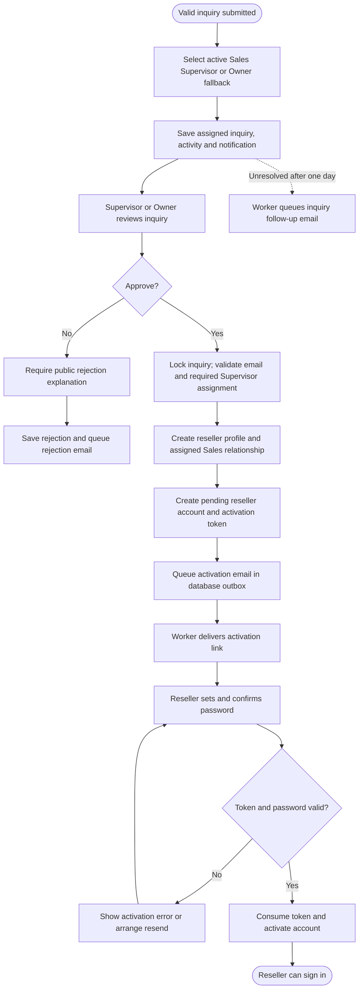

Approval and account creation are transactional; activation email delivery is asynchronous. An inquiry can notify Owner when no Supervisor is available, but approval through `add_reseller_from_inquiry` still needs a Supervisor assignment; Owner fallback does not remove that provisioning prerequisite. Supervisor and Owner account-management routes also support account provisioning outside a public inquiry.

## M04 — Reseller cart, payment and order fulfillment

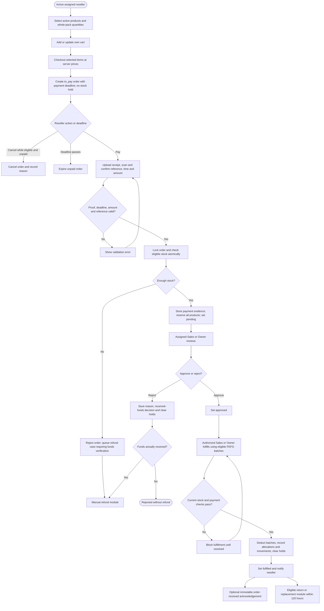

The state named `fulfilled` is shown as **Completed** in reseller history. Acknowledgement neither fulfills the order again nor restarts the return window. The payment deadline is configurable; it should not be assumed to be a universal fixed value. Approved orders have no ordinary reject/cancel path in this workflow. `order_stock_reservations` holds product quantities; batches are chosen again at fulfillment using FEFO.

## M05 — Counter sales

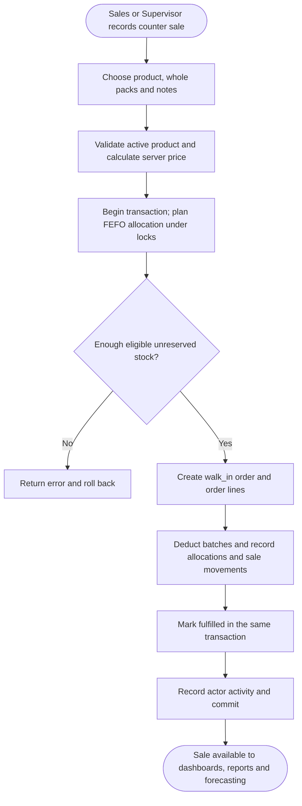

The diagram groups atomic steps by business purpose. `create_order_from_items` inserts order records before allocation; allocation failure rolls back the transaction. Counter sales do not use the reseller `to_pay` stage.

## M06 — Materials, product definitions and production

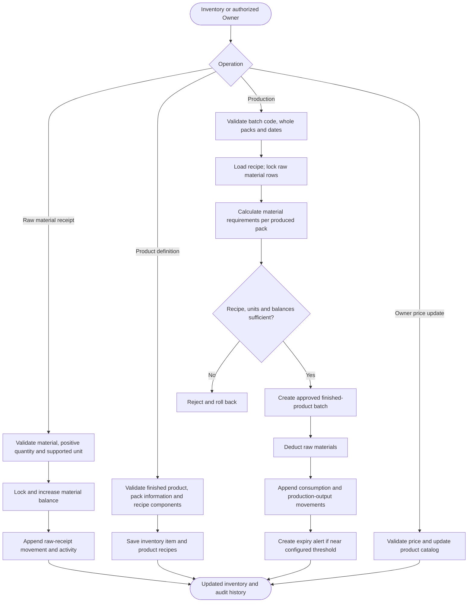

Raw materials and finished products share `inventory_items`, differentiated by `item_type`. Finished goods are tracked in batches and whole packs; raw materials support defined decimal-unit quantities. Production is a transaction, not a forecast-triggered background operation. A direct finished-batch receipt repository helper remains in `products.py`, but no current portal caller was found, so it is excluded from this active UI flow.

## M07 — Expiry, pull-outs and disposal

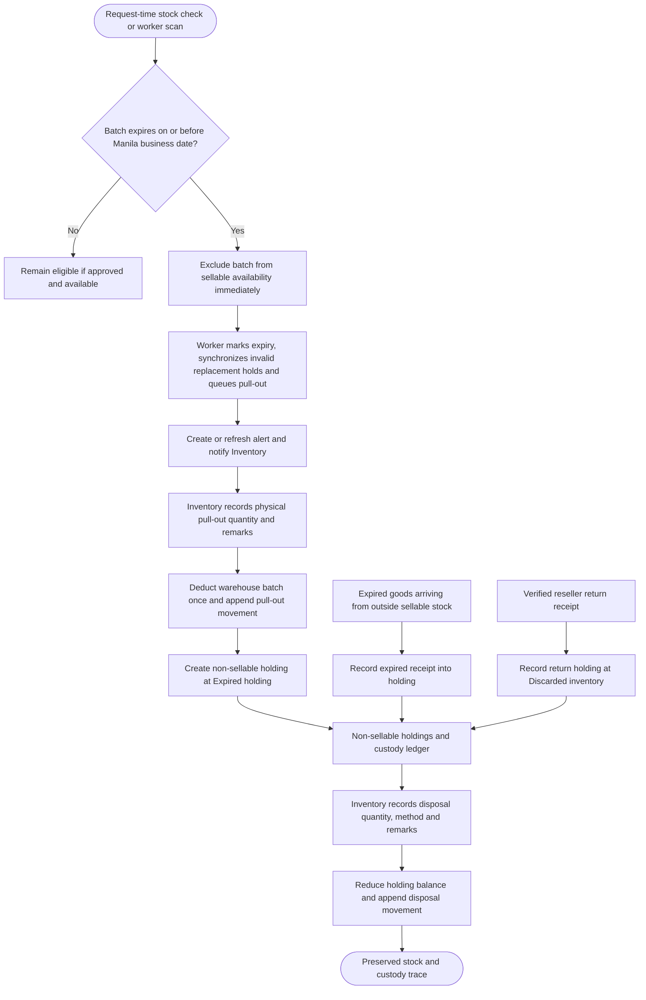

Queueing a pull-out is a zero-physical-delta status event. Physical pull-out performs the warehouse deduction. Returned goods enter a separate custody ledger and never increase sellable stock. The table `expired_holdings` also stores returned goods despite its historical name.

## M08 — Product returns, refund-only requests and version-1 replacement cases

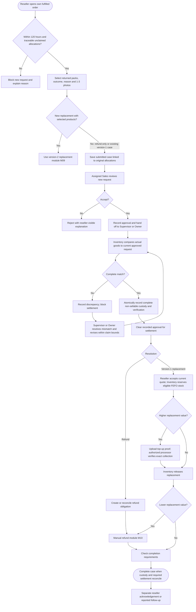

Normal complete-match receipt authorizes the existing approval in the Inventory transaction; older cases can still require historical/manual reconciliation. Regular Sales becomes tracking-only after handoff. The original order and fulfilled-sale allocation remain intact.

## M09 — Version-2 replacement workflow

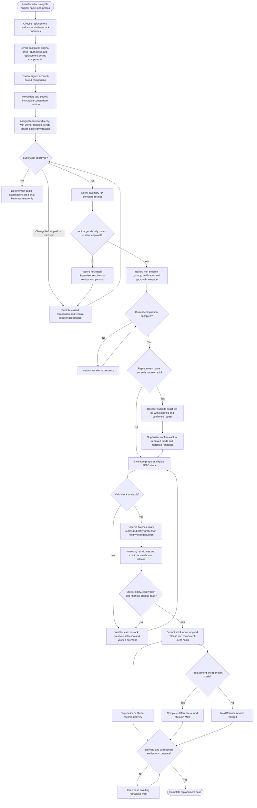

Credit covers only selected returned packs at original paid prices. Matching same-product quantities retain those prices; excess or different products use catalog pricing captured in the comparison. Version 2 collects any top-up **before preparation**. Preparation and release are separate actions. Delivery and any required refund must both complete before the case completes.

## M10 — Manual money refunds

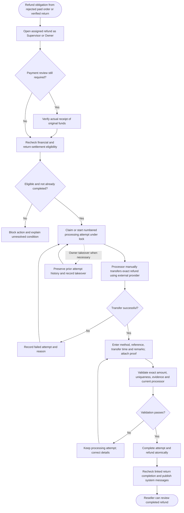

The application records the manual transfer; it does not initiate the transfer. Refund screenshots alone do not establish original collection. Failed attempts remain recorded, and operation keys protect supported retries.

## M11 — Sales activity reporting and exports

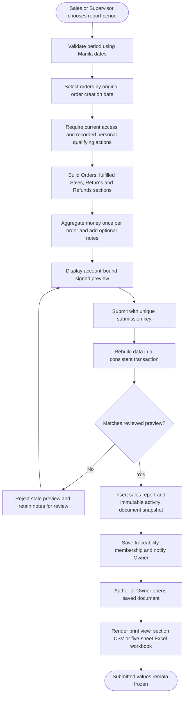

Assignment alone is insufficient for report attribution. Replacement releases and top-ups are not new ordinary sales. Only completed refunds against fulfilled sales reduce retained sales. New reports use saved JSON documents; legacy report behavior remains supported. Reseller sell-through repository helpers and schema remain, but the inspected current reseller portal does not expose an active submission route; they are not shown as an active module here.

## M12 — Demand forecasting

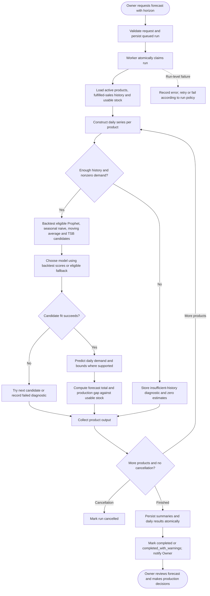

This is an implemented model-selection pipeline, not a guarantee that Prophet is always selected. Forecasting uses local Python libraries. An insufficient-history zero is diagnostic output, not evidence of zero future demand. `production_gap` is forecast total minus usable stock, so a negative value is possible.

## M13 — Public live chat

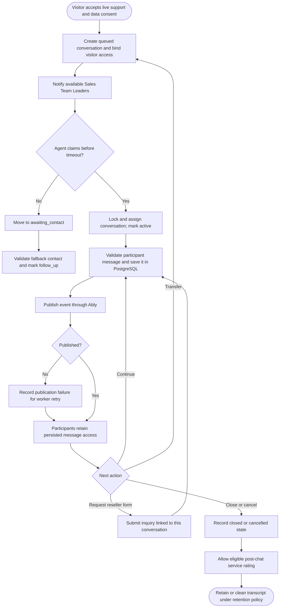

Public live chat has its own tables, visitor authorization and Ably publication retry state. It is distinct from internal reseller conversations and replacement case messages. Current availability and claim queries require `team_leader_role='sales'`; Supervisor navigation/capabilities alone do not establish eligibility to claim public chats.

## M14 — Private conversations and unread state

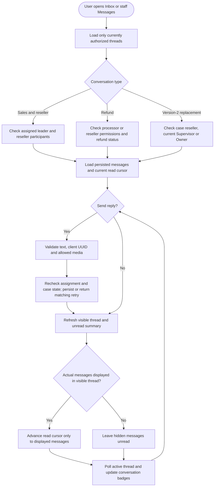

General reseller conversations support private image/video attachments; version-2 case chat is text-based, with evidence and payment in linked return details. Refund conversations close to new replies when completed; declined replacement cases are read-only. Private media downloads recheck authorization. The replacement thread polls while visible; it does not require a new realtime provider.

## M15 — Owner administration and handover

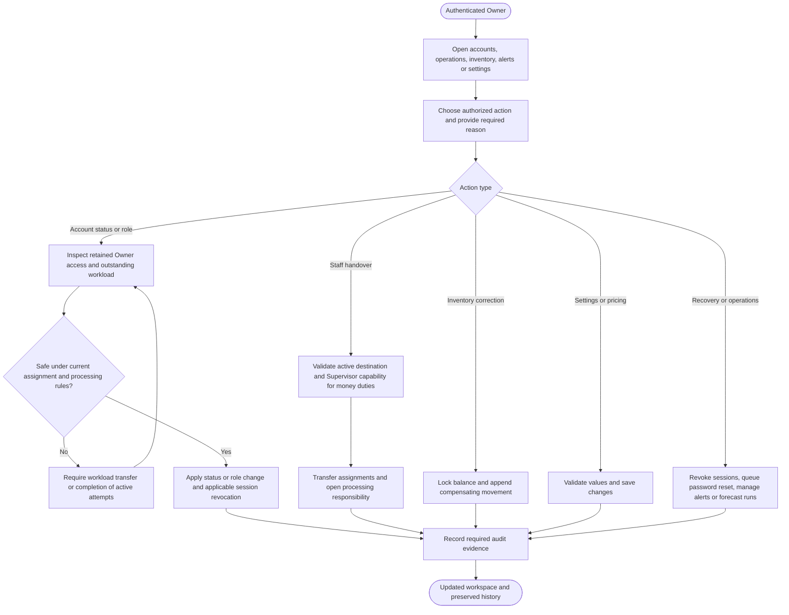

Handover respects current return/refund processing duties and private conversation scope. In-progress refund transfers require their existing completion, failure or Owner takeover flow. Corrections append movements rather than editing immutable stock history. No additional Owner step-up email challenge is required in the current portal.

## M16 — Background jobs and notifications

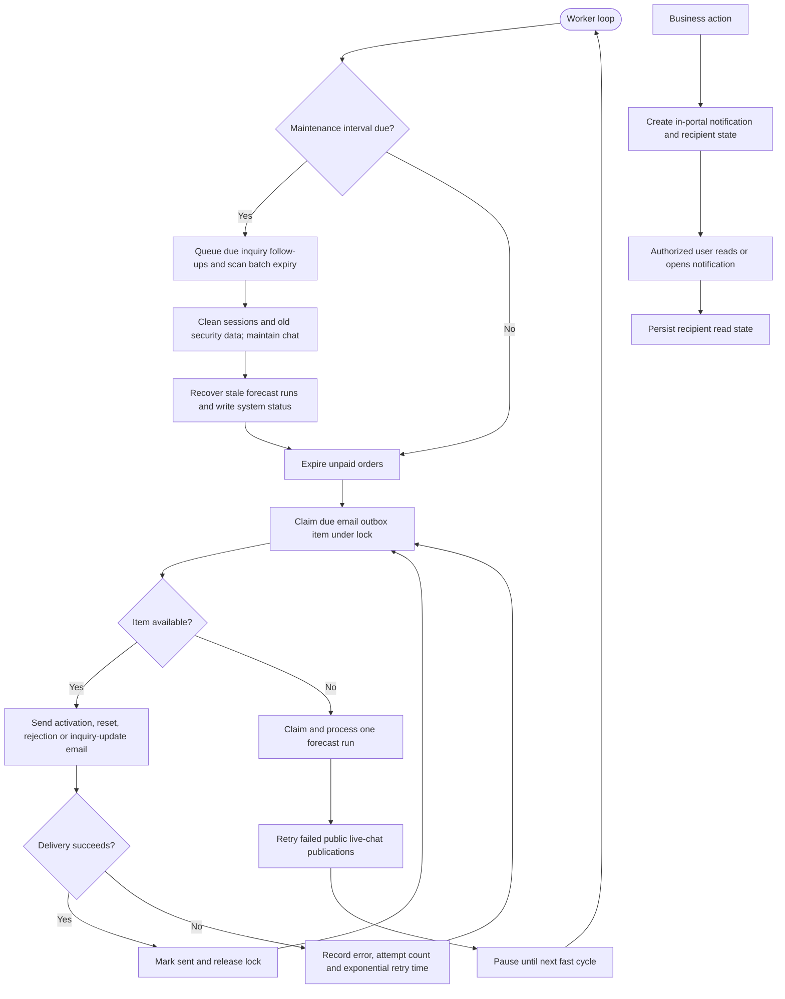

The current worker targets a five-second fast cycle and maintenance about every sixty seconds. A slow synchronous task can lengthen the loop. Email outbox claims stop after the configured code limit of eight delivery attempts; failed delivery is not silently treated as success. Login and password-change OTP emails use request-time sending rather than this outbox.

## M17 — Dashboards and operational monitoring

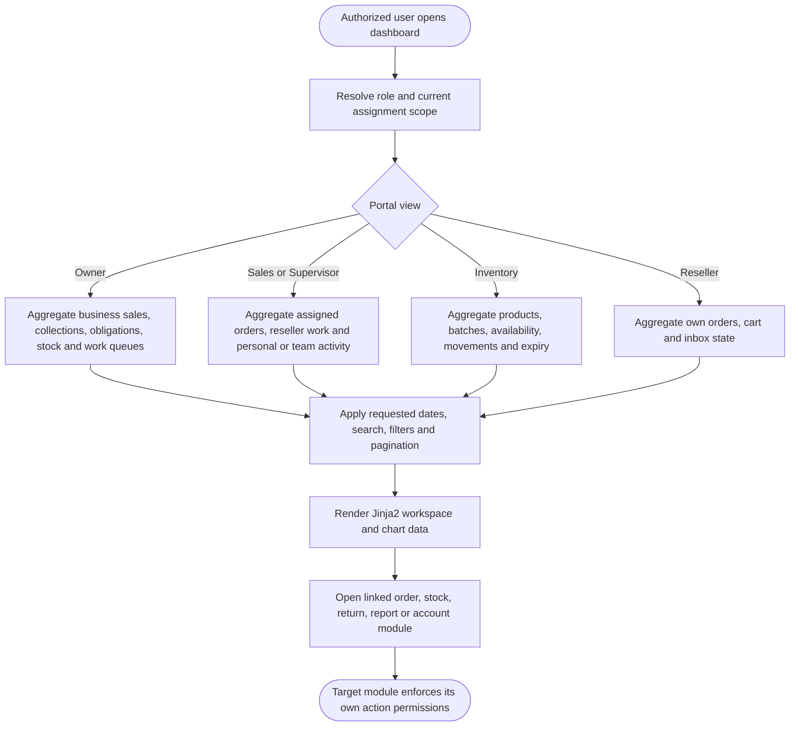

Physical stock, sellable stock, reserved stock, gross sales, retained sales and net collections have different meanings. Dashboard totals do not replace the transaction and settlement checks.

## M18 — Profile and account recovery

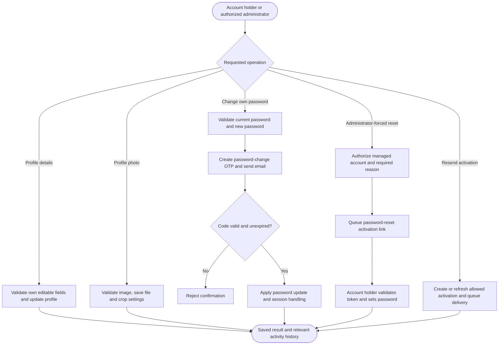

Legacy Owner form-draft recovery helpers remain in `app/owner_recovery.py`; their presence does not imply a public self-service password-reset endpoint. Profile photos live in the upload volume, while account references and crop settings live in PostgreSQL.

## Role-oriented portal summary: Owner

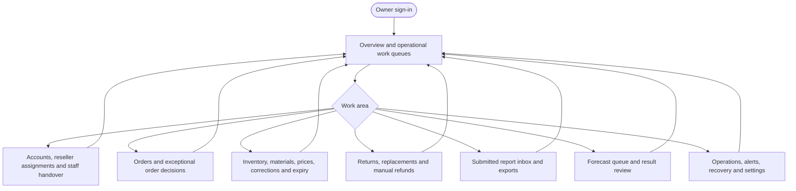

## Role-oriented portal summary: Sales and Supervisor

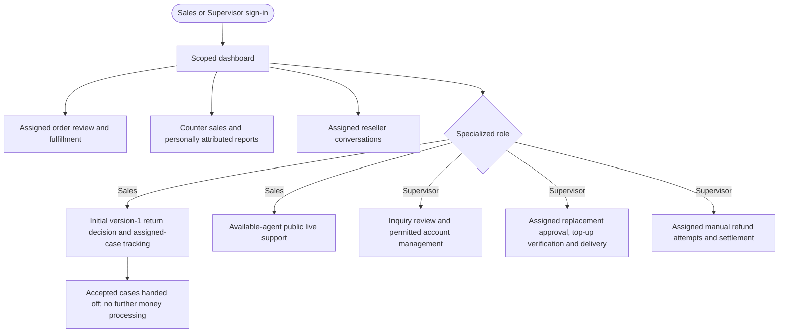

## Role-oriented portal summary: Inventory

```mermaid
flowchart TD
    A([Inventory sign-in]) --> B[Stock and expiry dashboard]
    B --> C[Receive materials and maintain product recipes]
    C --> D[Produce and record finished batches]
    B --> E[Inspect complete return receipt or report mismatch]
    E --> F[Record verified non-sellable custody]
    F --> G[Prepare financially cleared replacement stock]
    G --> H[Mark ready, then separately release warehouse goods]
    B --> I[Physically pull out expired stock]
    I --> J[Record holding and later disposal]
    B --> K[Inspect batch history and immutable movement logs]
```

## Role-oriented portal summary: Reseller

```mermaid
flowchart TD
    A([Activated reseller sign-in]) --> B[Browse products and manage own cart]
    B --> C[Checkout to unpaid order]
    C --> D[Submit receipt and confirmed payment details before deadline]
    D --> E[Track Sales review and fulfillment]
    E --> F[Optionally acknowledge order received]
    E --> G{After-sales request within 120 hours?}
    G -->|Refund| H[Submit allocation quantities, reason and photos]
    G -->|Replacement| I[Choose products and submit reviewed comparison]
    H --> J[Track decision, custody and settlement]
    I --> J
    J --> K[Accept revisions, pay top-up when due or review refund]
    K --> L[Review replacement delivery and completion]
    E --> M[Read order updates or message authorized staff]
    L --> M
```

## Source verification boundaries

These are source-derived flows, not results from a fresh end-to-end test run. Relevant existing regression files include `tests/test_portal_improvements.py`, `tests/test_inventory_receipt_decision.py`, `tests/test_return_workflow_handoff.py`, `tests/test_replacement_workflow.py`, `tests/test_refund_traceability.py`, `tests/test_activity_reports.py`, `tests/test_forecasting.py`, `tests/test_live_chat.py`, and `tests/test_internal_conversation_media.py`. No passing-test or deployment claim is made here.
