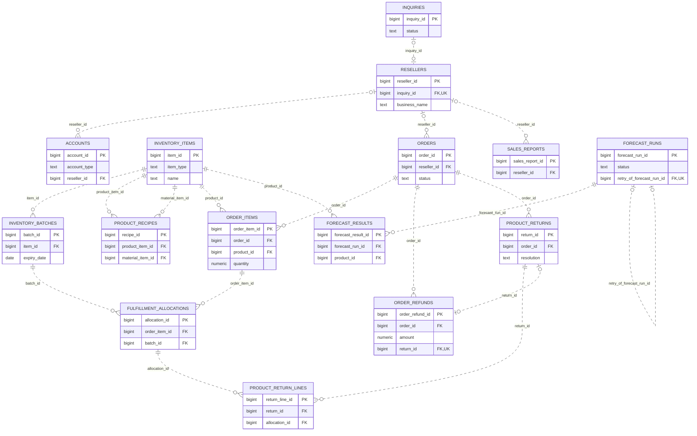
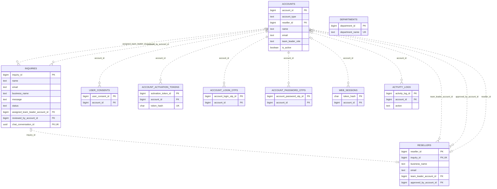
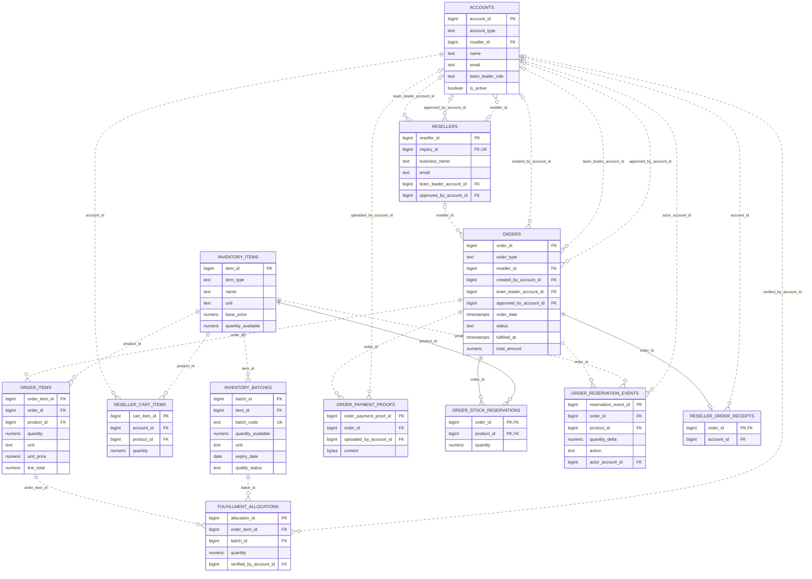
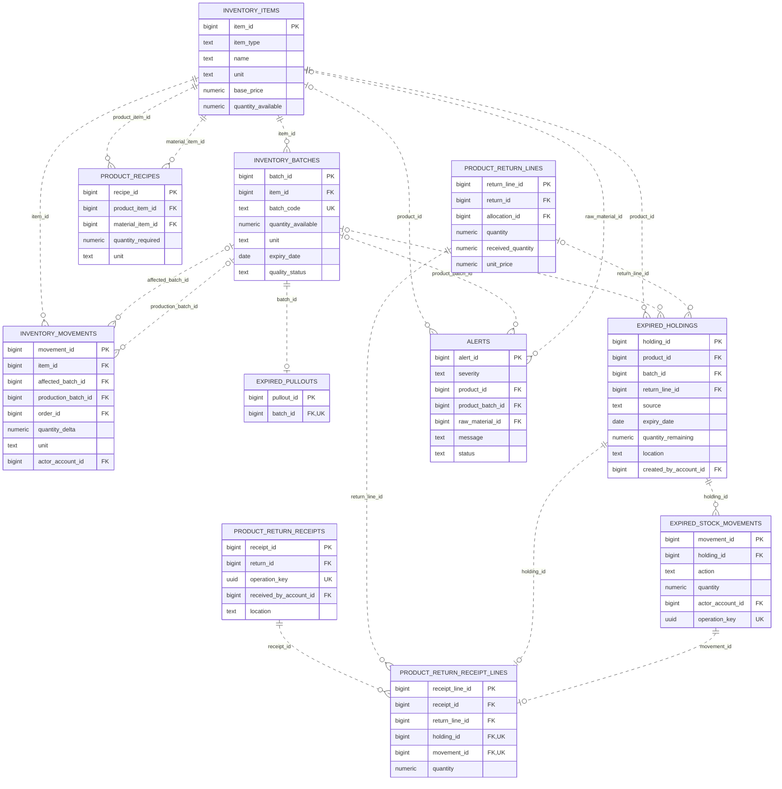
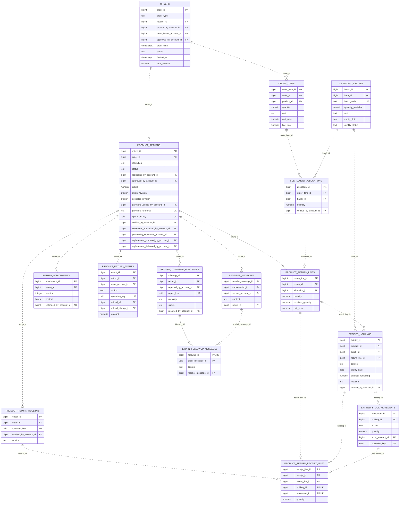
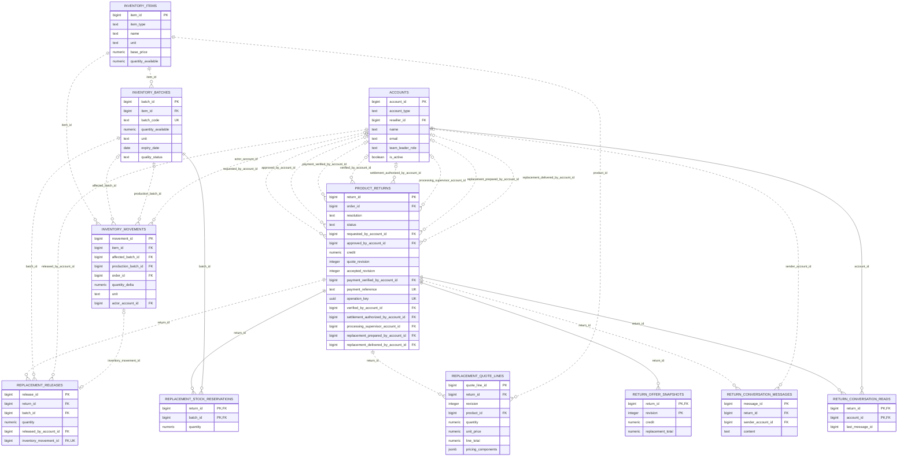
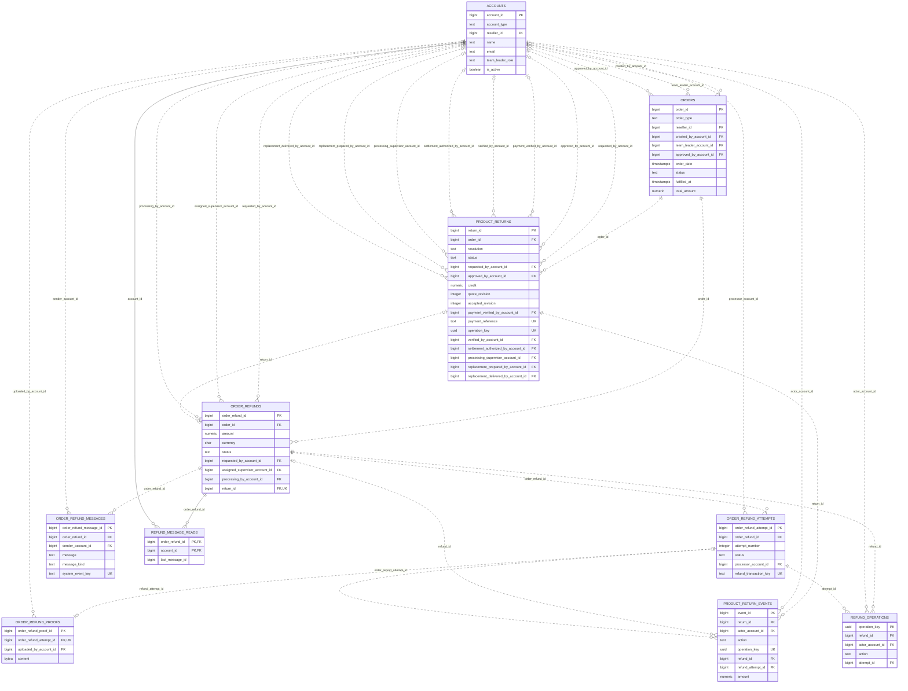
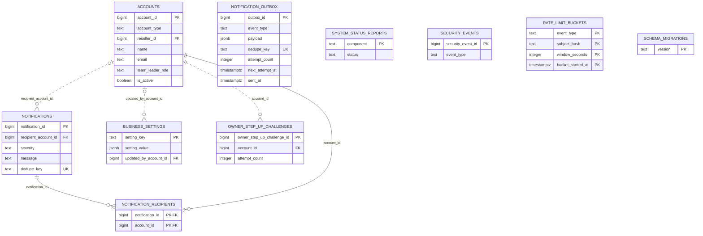

# MEATTRACK entity-relationship diagrams

Source review: **2026-10-31**, current local `database/schema.sql` including its final `ALTER TABLE` and index definitions through migration **044**, plus the migration runner's metadata table. SQL was parsed as PostgreSQL syntax rather than inferred from screen labels.

## How to read these diagrams

- `PK` identifies primary-key columns. Multiple `PK` columns in an entity form one composite key.
- `FK` identifies declared foreign-key columns. `UK` identifies an unconditional single-column unique key, or a unique non-null value index. Composite unique constraints and general partial/expression indexes are explained in prose rather than attaching a misleading single-column UK.
- At the parent end, `||` means exactly one and `|o` means zero or one; at the child end, `o{` means zero or many and `o|` means zero or one.
- Solid relationships identify a foreign key contained in the child's primary key; dotted relationships are non-identifying foreign keys.
- Cardinality follows physical constraints, including nullable FKs. It does not express every business rule, such as requiring order items through application validation.
- Domain diagrams retain key columns plus selected business attributes. The full schema diagram includes every column and declared foreign key. Types are normalized for readability; precision, defaults, checks and trigger bodies remain authoritative in SQL.

## Coverage

The baseline declares **71 tables**; `tools/migrate_database.py` creates **1 additional metadata table**, `schema_migrations`. The complete diagram therefore contains **72 tables**. The existing `database/meattrack_erd.mmd` is an older partial view and was not used as the schema authority.

## Business-core ERD

Presentation overview. Selected entities and direct declared foreign keys are shown; support tables are expanded below. Actor edges are suppressed here to reduce crossings.

[Standalone Mermaid source](mermaid/erd-core.mmd).

## Identity, onboarding and sessions

Accounts reference reseller profiles with a nullable, non-unique foreign key. A reseller profile can therefore have multiple referencing account rows at the schema level. Application provisioning normally creates a reseller login for an approved profile. Account email uniqueness uses a case-insensitive expression index.

[Standalone Mermaid source](mermaid/erd-identity.mmd).

## Cart, orders, payment and fulfillment

Paid order holds reference products, not particular batches. Fulfillment allocations connect order items to the actual batches supplied. A reseller receipt acknowledgement is optional and unique per order.

[Standalone Mermaid source](mermaid/erd-orders.mmd).

## Production, stock and non-sellable custody

The two recipe foreign keys both reference inventory_items: one finished product and one material. expired_holdings stores expired pull-outs, expired arrivals and reseller returns. Receipt lines uniquely link their custody holding and movement. External account/order/allocation anchors are omitted in this view.

[Standalone Mermaid source](mermaid/erd-inventory.mmd).

## Return cases, receipt trace and customer follow-ups

Every return line references an original fulfillment allocation. Requested quantity and actual received quantity are distinct. Customer follow-ups and optional linked general-chat messages retain their own records. Case actor edges are expanded in the full ERD.

[Standalone Mermaid source](mermaid/erd-returns.mmd).

## Replacement quotations, preparation, release and messages

The physical schema stores quote revisions as values; it does not declare a composite foreign key from quote lines to offer snapshots. Preparation and delivery metadata live on product_returns. Replacement messages and per-account read cursors are separate tables.

[Standalone Mermaid source](mermaid/erd-replacement.mmd).

## Refund obligations, transfer attempts and evidence

orders to order_refunds is one-to-many in the final schema: the original whole-order UNIQUE was dropped. Partial unique indexes allow one non-return rejection refund per order and one refund per non-null return_id. Each transfer proof is unique per attempt. Refund operations preserve idempotent request traceability.

[Standalone Mermaid source](mermaid/erd-refunds.mmd).

## Reports and forecasting

Activity snapshots are optional one-to-one saved documents for reports; legacy reports need not have one. Membership tables preserve order/refund traceability. Forecast results and summaries reference both their run and product; a retry run can reference an earlier run.

```mermaid
erDiagram

    ACCOUNTS {
        bigint account_id PK
        text account_type
        bigint reseller_id FK
        text name
        text email
        text team_leader_role
        boolean is_active
    }

    DEPARTMENTS {
        bigint department_id PK
        text department_name UK
    }

    RESELLERS {
        bigint reseller_id PK
        bigint inquiry_id FK, UK
        text business_name
        text email
        bigint team_leader_account_id FK
        bigint approved_by_account_id FK
    }

    ORDERS {
        bigint order_id PK
        text order_type
        bigint reseller_id FK
        bigint created_by_account_id FK
        bigint team_leader_account_id FK
        bigint approved_by_account_id FK
        timestamptz order_date
        text status
        timestamptz fulfilled_at
        numeric total_amount
    }

    ORDER_REFUNDS {
        bigint order_refund_id PK
        bigint order_id FK
        numeric amount
        char currency
        text status
        bigint requested_by_account_id FK
        bigint assigned_supervisor_account_id FK
        bigint processing_by_account_id FK
        bigint return_id FK, UK
    }

    INVENTORY_ITEMS {
        bigint item_id PK
        text item_type
        text name
        text unit
        numeric base_price
        numeric quantity_available
    }

    SALES_REPORTS {
        bigint sales_report_id PK
        text report_source
        bigint submitted_by_account_id FK
        bigint reseller_id FK
        bigint department_id FK
        date period_start
        date period_end
        numeric total_sales
        integer total_orders
    }

    SALES_REPORT_ITEMS {
        bigint sales_report_item_id PK
        bigint sales_report_id FK
        bigint product_id FK
        text unit
        numeric unit_price
        numeric line_total
    }

    SALES_REPORT_ATTACHMENTS {
        bigint sales_report_attachment_id PK
        bigint sales_report_id FK
        bytea content
    }

    SALES_REPORT_ORDERS {
        bigint sales_report_id PK, FK
        bigint order_id PK, FK
    }

    SALES_REPORT_REFUNDS {
        bigint sales_report_id PK, FK
        bigint order_refund_id PK, FK
        numeric amount
    }

    SALES_REPORT_ACTIVITY_SNAPSHOTS {
        bigint sales_report_id PK, FK
        bigint author_account_id FK
        uuid submission_key UK
        smallint schema_version
        jsonb payload
    }

    FORECAST_RUNS {
        bigint forecast_run_id PK
        bigint run_by_account_id FK
        text model_name
        integer forecast_horizon_days
        text status
        integer attempt_count
        timestamptz next_attempt_at
        bigint retry_of_forecast_run_id FK, UK
    }

    FORECAST_PRODUCT_SUMMARIES {
        bigint forecast_product_summary_id PK
        bigint forecast_run_id FK
        bigint product_id FK
        text method
        text diagnostic_status
        numeric forecast_total
        numeric usable_stock
        numeric production_gap
    }

    FORECAST_RESULTS {
        bigint forecast_result_id PK
        bigint forecast_run_id FK
        bigint product_id FK
        date forecast_date
        numeric predicted_quantity
    }

    ACCOUNTS |o..o{ RESELLERS : "team_leader_account_id"
    ACCOUNTS |o..o{ RESELLERS : "approved_by_account_id"
    RESELLERS |o..o{ ACCOUNTS : "reseller_id"
    RESELLERS |o..o{ ORDERS : "reseller_id"
    ACCOUNTS |o..o{ ORDERS : "created_by_account_id"
    ACCOUNTS |o..o{ ORDERS : "team_leader_account_id"
    ACCOUNTS |o..o{ ORDERS : "approved_by_account_id"
    ORDERS ||..o{ ORDER_REFUNDS : "order_id"
    ACCOUNTS |o..o{ ORDER_REFUNDS : "requested_by_account_id"
    ACCOUNTS |o..o{ ORDER_REFUNDS : "assigned_supervisor_account_id"
    ACCOUNTS |o..o{ ORDER_REFUNDS : "processing_by_account_id"
    ACCOUNTS |o..o{ SALES_REPORTS : "submitted_by_account_id"
    RESELLERS |o..o{ SALES_REPORTS : "reseller_id"
    DEPARTMENTS |o..o{ SALES_REPORTS : "department_id"
    SALES_REPORTS ||..o{ SALES_REPORT_ITEMS : "sales_report_id"
    INVENTORY_ITEMS ||..o{ SALES_REPORT_ITEMS : "product_id"
    SALES_REPORTS ||..o{ SALES_REPORT_ATTACHMENTS : "sales_report_id"
    ACCOUNTS |o..o{ FORECAST_RUNS : "run_by_account_id"
    FORECAST_RUNS ||..o{ FORECAST_PRODUCT_SUMMARIES : "forecast_run_id"
    INVENTORY_ITEMS ||..o{ FORECAST_PRODUCT_SUMMARIES : "product_id"
    FORECAST_RUNS ||..o{ FORECAST_RESULTS : "forecast_run_id"
    INVENTORY_ITEMS ||..o{ FORECAST_RESULTS : "product_id"
    FORECAST_RUNS |o..o| FORECAST_RUNS : "retry_of_forecast_run_id"
    SALES_REPORTS ||--o{ SALES_REPORT_ORDERS : "sales_report_id"
    ORDERS ||--o{ SALES_REPORT_ORDERS : "order_id"
    SALES_REPORTS ||--o{ SALES_REPORT_REFUNDS : "sales_report_id"
    ORDER_REFUNDS ||--o{ SALES_REPORT_REFUNDS : "order_refund_id"
    SALES_REPORTS ||--o| SALES_REPORT_ACTIVITY_SNAPSHOTS : "sales_report_id"
    ACCOUNTS ||..o{ SALES_REPORT_ACTIVITY_SNAPSHOTS : "author_account_id"
```

[Standalone Mermaid source](mermaid/erd-reporting.mmd).

## Public chat, internal conversations and notifications

Public chat, internal reseller chat and order system messages are separate stores. Replacement case chat and refund conversations appear in their domain ERDs. Client UUIDs and last-read message numbers do not create undeclared foreign keys.

```mermaid
erDiagram

    ACCOUNTS {
        bigint account_id PK
        text account_type
        bigint reseller_id FK
        text name
        text email
        text team_leader_role
        boolean is_active
    }

    CHAT_CONVERSATIONS {
        uuid conversation_id PK
        text status
        bigint assigned_team_leader_account_id FK
    }

    CHAT_MESSAGES {
        bigint chat_message_id PK
        uuid conversation_id FK
        bigint sender_account_id FK
        text content
        text publication_status
    }

    CHAT_SERVICE_RATINGS {
        uuid conversation_id PK, FK
        bigint team_leader_account_id FK
    }

    TEAM_LEADER_PRESENCE {
        bigint account_id PK, FK
        uuid active_conversation_id FK
    }

    RESELLER_CONVERSATIONS {
        bigint conversation_id PK
        bigint reseller_account_id FK
        bigint team_leader_account_id FK
    }

    RESELLER_MESSAGES {
        bigint reseller_message_id PK
        bigint conversation_id FK
        bigint sender_account_id FK
        text content
        bigint return_id FK
    }

    RESELLER_MESSAGE_ATTACHMENTS {
        bigint attachment_id PK
        bigint reseller_message_id FK
        bytea content
    }

    PRODUCT_RETURNS {
        bigint return_id PK
        bigint order_id FK
        text resolution
        text status
        bigint requested_by_account_id FK
        bigint approved_by_account_id FK
        numeric credit
        integer quote_revision
        integer accepted_revision
        bigint payment_verified_by_account_id FK
        text payment_reference UK
        uuid operation_key UK
        bigint verified_by_account_id FK
        bigint settlement_authorized_by_account_id FK
        bigint processing_supervisor_account_id FK
        bigint replacement_prepared_by_account_id FK
        bigint replacement_delivered_by_account_id FK
    }

    NOTIFICATIONS {
        bigint notification_id PK
        bigint recipient_account_id FK
        text severity
        text message
        text dedupe_key UK
    }

    NOTIFICATION_RECIPIENTS {
        bigint notification_id PK, FK
        bigint account_id PK, FK
    }

    ORDER_SYSTEM_MESSAGES {
        bigint order_system_message_id PK
        bigint reseller_account_id FK
        bigint order_id FK
        text event_type
        text message
        text dedupe_key UK
        bigint order_refund_attempt_id FK
    }

    ORDERS {
        bigint order_id PK
        text order_type
        bigint reseller_id FK
        bigint created_by_account_id FK
        bigint team_leader_account_id FK
        bigint approved_by_account_id FK
        timestamptz order_date
        text status
        timestamptz fulfilled_at
        numeric total_amount
    }

    ORDER_REFUND_ATTEMPTS {
        bigint order_refund_attempt_id PK
        bigint order_refund_id FK
        integer attempt_number
        text status
        bigint processor_account_id FK
        text refund_transaction_key UK
    }

    ACCOUNTS |o..o{ ORDERS : "created_by_account_id"
    ACCOUNTS |o..o{ ORDERS : "team_leader_account_id"
    ACCOUNTS |o..o{ ORDERS : "approved_by_account_id"
    ACCOUNTS ||..o{ ORDER_REFUND_ATTEMPTS : "processor_account_id"
    ACCOUNTS |o..o{ NOTIFICATIONS : "recipient_account_id"
    ACCOUNTS ||..o{ ORDER_SYSTEM_MESSAGES : "reseller_account_id"
    ORDERS ||..o{ ORDER_SYSTEM_MESSAGES : "order_id"
    ORDER_REFUND_ATTEMPTS |o..o{ ORDER_SYSTEM_MESSAGES : "order_refund_attempt_id"
    NOTIFICATIONS ||--o{ NOTIFICATION_RECIPIENTS : "notification_id"
    ACCOUNTS ||--o{ NOTIFICATION_RECIPIENTS : "account_id"
    ACCOUNTS |o..o{ CHAT_CONVERSATIONS : "assigned_team_leader_account_id"
    CHAT_CONVERSATIONS ||..o{ CHAT_MESSAGES : "conversation_id"
    ACCOUNTS |o..o{ CHAT_MESSAGES : "sender_account_id"
    ACCOUNTS ||..o{ RESELLER_CONVERSATIONS : "reseller_account_id"
    ACCOUNTS ||..o{ RESELLER_CONVERSATIONS : "team_leader_account_id"
    RESELLER_CONVERSATIONS ||..o{ RESELLER_MESSAGES : "conversation_id"
    ACCOUNTS ||..o{ RESELLER_MESSAGES : "sender_account_id"
    CHAT_CONVERSATIONS ||--o| CHAT_SERVICE_RATINGS : "conversation_id"
    ACCOUNTS ||..o{ CHAT_SERVICE_RATINGS : "team_leader_account_id"
    ACCOUNTS ||--o| TEAM_LEADER_PRESENCE : "account_id"
    CHAT_CONVERSATIONS |o..o{ TEAM_LEADER_PRESENCE : "active_conversation_id"
    ORDERS ||..o{ PRODUCT_RETURNS : "order_id"
    ACCOUNTS ||..o{ PRODUCT_RETURNS : "requested_by_account_id"
    ACCOUNTS |o..o{ PRODUCT_RETURNS : "approved_by_account_id"
    ACCOUNTS |o..o{ PRODUCT_RETURNS : "payment_verified_by_account_id"
    ACCOUNTS |o..o{ PRODUCT_RETURNS : "verified_by_account_id"
    ACCOUNTS |o..o{ PRODUCT_RETURNS : "settlement_authorized_by_account_id"
    PRODUCT_RETURNS |o..o{ RESELLER_MESSAGES : "return_id"
    ACCOUNTS |o..o{ PRODUCT_RETURNS : "processing_supervisor_account_id"
    RESELLER_MESSAGES ||..o{ RESELLER_MESSAGE_ATTACHMENTS : "reseller_message_id"
    ACCOUNTS |o..o{ PRODUCT_RETURNS : "replacement_prepared_by_account_id"
    ACCOUNTS |o..o{ PRODUCT_RETURNS : "replacement_delivered_by_account_id"
```

[Standalone Mermaid source](mermaid/erd-messaging.mmd).

## Operational settings, delivery and migration metadata

Tables without relational links are deliberately retained. Outbox payloads and generic source IDs do not become foreign keys merely because application code interprets them. owner_step_up_challenges remains in the schema even though the current Owner portal no longer requires its separate email challenge. schema_migrations is created by the migration runner.

[Standalone Mermaid source](mermaid/erd-operations.mmd).

## Complete physical schema

The full ERD is intentionally separate because its 72 tables are unsuitable for a presentation slide:

- [Complete Mermaid source](mermaid/erd-full-schema.mmd)
- [Rendered full-schema SVG](rendered/erd-full-schema.svg)
- [Schema inventory and foreign-key details](schema-inventory.json)

Its disconnected entities are real tables, not missing relationships. Logical links inside JSON snapshots, generic audit `entity_id` values, settings payloads and message read cursors are not drawn as invented foreign keys.

## Important schema and workflow distinctions

1. **One reseller does not imply exactly one account at the database level.** `accounts.reseller_id` is not unique.
2. **One order may have several refund records.** The old unconditional unique `order_id` constraint is removed later in the schema; conditional uniqueness distinguishes rejection refunds from return-case refunds.
3. **Products and materials are one entity type with a discriminator.** Their quantities and workflows differ, and finished goods have individual batch rows.
4. **Stock reservation and physical movement are different records.** Reservation events do not deduct warehouse stock.
5. **Returns do not replenish sellable batches.** Their physical receipt is tracked through holdings, custody movements and receipt-line links.
6. **A saved report is not a live query result.** New report content is frozen in `sales_report_activity_snapshots.payload`.
7. **A read cursor is not necessarily a foreign key.** Numeric message IDs without REFERENCES are retained as attributes.
8. **A retained table is not proof of an active UI module.** For example, legacy step-up and reseller-report structures remain in the schema.

## Source basis

[`database/schema.sql`](../../database/schema.sql), [`database/migrations/`](../../database/migrations/), [`tools/migrate_database.py`](../../tools/migrate_database.py), and the repositories cited in [module flowcharts](03-module-flowcharts.md). This is a static schema analysis; no live production database was inspected.
