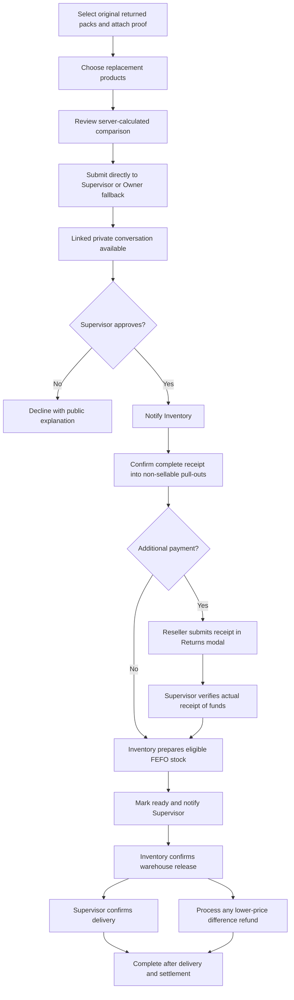

# Replacement workflow

## Replacement-first policy update (2026-11-03, verified locally)

New submissions retain workflow version 2 and carry separate `return_policy_version=2`.
Their initial replacement is derived from the approved returned allocation
products/quantities at original paid prices, including when catalog prices change.
New direct refund requests and reseller-selected substitutes are rejected.
Supervisor/Owner may offer equal/higher-value alternatives with a public explanation;
changed offers require fresh acceptance. Lower-value selections are rejected.

Authorized conversion before warehouse release preserves history and returns
approved credit plus any verified top-up through one component-aware refund.
It clears replacement holds/preparation and blocks further replacement actions.
Unverified payment evidence must be resolved explicitly first. Complete Inventory
receipt still gates settlement; converted cases do not require delivery.

The following original selection/difference-refund descriptions apply to historical
policy-1 cases. Those cases retain their recorded behavior. The current Reseller
request form derives the replacement and supports input-preserving comparison and
submission retry. Supervisor pages and Owner dialogs share confirmation, inline
validation and error recovery for new-policy offers/conversion. Converted offers
remain historical without acceptance/payment/release actions; the grouped Inbox
shows refund components. The final 1,027-case regression, verified local restore/reset
and eight post-maintenance smoke checks passed; all five role queues were checked
read-only. This does not establish production deployment. Current flow diagrams are in
`docs/diagrams/05-replacement-first-policy.md`.
Sources: `app/repositories/return_policy.py`, `app/repositories/replacement_workflow.py`,
`app/repositories/product_returns.py`, migration 048,
`app/reseller_contact_history.py`, `app/static/js/reseller_contact_history.js`,
`app/static/js/forms.js`, `app/static/js/return_details.js`,
`tests/test_replacement_first_policy.py`, `tests/test_replacement_first_stock.py`,
`tests/test_replacement_first_portal.py`, `tests/test_replacement_first_converted_history.py`.
Migration 049 scopes the deferred policy check to new-policy rows; legacy rows
retain their existing reconciliation/migration behavior. See [[Database and Operations]].
See [[Decisions]], [[Returns and Financials]], [[Testing and Change Impact]].

The later 2026-11-02 Inbox refinement groups eligible reseller histories by current
processor account, including existing direct messages when that account is also
the current direct-chat leader. It retains each case's underlying messages,
permissions, identifiers, read cursor, and declined-case write restriction.
The reseller chooses a case in the shared view when replying about a replacement.
Regular Sales does not gain access to a different Supervisor's private case chat.
This supersedes the earlier reseller case-row navigation description; staff views
retain their existing layout. See [[Background Work and Integrations]]. Sources:
`app/reseller_contact_history.py`, `app/static/js/reseller_contact_history.js`,
`app/repositories/replacement_messages.py`.

New reseller replacement submissions use **replacement workflow version 2**.
Existing cases and refund-only requests keep version 1 and their original rules,
quotes, evidence, approvals, stock history, and completion behavior. This is the
user-directed replacement process introduced on 2026-10-30, not a reinterpretation
of historical cases. See [[Returns and Financials]], [[Orders and Inventory]],
[[Roles and Access]], and [[Sales and Reseller Returns]].

## Request and recorded comparison

The reseller starts from a fulfilled order within its unchanged 120-hour eligibility
window, selects traceable original allocation quantities, gives a reason, and
attaches 1–3 supporting photos. They then select active finished replacement
products in whole packs and review the comparison before submitting.

The comparison builder is server-side. It calculates credit from **selected returned
packs at original purchase prices**, never from the whole order. Matching quantities
of the same product retain their original paid prices; additional packs and
different products use catalog prices at comparison time. Multiple original price
lines match in ascending original allocation ID order. Line totals are authoritative;
separate pricing components retain each original/catalog contribution, even when
an average display unit price has to be rounded.

An account/order-bound signed comparison expires after one hour. Submission
rechecks eligibility, remaining unclaimed quantities, products, and comparison
values. A stale/tampered comparison requires review again. The submitted comparison
becomes immutable offer revision 1 and counts as the reseller's acceptance of that
selection. Same-product/no-difference requests still retain their comparison.
The original order and ordinary sales ledger are not recreated.

Submission, quote publication, direct Supervisor assignment, initial conversation,
evidence, and notifications commit in the same transaction. An available Supervisor
is selected through the existing assignment helper, preferring an eligible original
Supervisor. Without one, Owner fallback applies. Regular Sales leaders track their
assigned reseller's progress but cannot approve or process a version-2 request.

The assigned Supervisor can approve unchanged products without repricing them.
Pre-payment changes to replacement products publish another comparison revision
and require reseller acceptance. An unresolved receipt mismatch can revise approved return quantities within original
delivery/remaining-claim bounds; it recalculates credit and publishes a new comparison
requiring fresh acceptance. Inventory still confirms the entire revised approved
request, never a partial receipt. Paid or released selections cannot be revised.

Sources: `app/repositories/replacement_workflow.py`,
`app/repositories/product_returns.py`, `app/portals/product_returns.py`,
`app/templates/portals/reseller/_return_request_dialog.html`.

## Receipt, payment, preparation, and delivery

Inventory is notified after approval. The complete-match/mismatch receipt decision
is retained, including approval revision checking. Complete receipt records goods
in the existing custody/holding ledger with source **return**, linked to original
allocations and the case. The **Pull-outs** workspace includes separate returned-
goods and expired-stock records. Returns never add sellable stock or deduct the
original sale a second time. Physical disposal remains a separate recorded action.

For a higher-value replacement, payment opens only after complete receipt,
settlement clearance, and current-comparison acceptance. The checkout is inside
the existing Returns tracking modal. It reuses receipt recognition, with a scan
token scoped to the reseller, replacement case, and exact proof. The reseller
checks/corrects reference, Manila date/time, and amount and confirms those details.
The submitted amount must equal the extra amount due.

The assigned Supervisor verifies the submitted reference and exact amount and must
explicitly confirm funds arrived in the payment provider. A screenshot alone does
not verify collection. Existing duplicate-proof/reference rules apply. Version 2
does not require a reservation before payment; version 1 retains that prerequisite.
Confirmed additional collections use the existing return financial ledger and are
not another ordinary sale.

Inventory's **Prepare and mark ready** action requires complete receipt, current
acceptance/authorization, and verified extra payment when due. It reserves eligible
unexpired batches using existing FEFO locking and allocation. Preparation records
the actor/time and notifies Supervisor/Owner; it does not deduct physical stock.
Warehouse release remains a separate Inventory action, revalidating stock, expiry,
reservations, quote, and payment and recording exactly one physical deduction.
Expiry blocks a batch starting midnight on its printed date in Manila.

If stock is unavailable or expires, preparation/release remains blocked. The paid
selection and verified payment remain recorded while waiting for valid restock;
the reseller is not charged again. After valid restocking, Inventory can prepare
again. The existing expiry worker clears invalid replacement holds, while request-
time checks remain authoritative if the worker is unavailable.

Release makes delivery outstanding. The assigned Supervisor/Owner records delivery
separately. A cheaper replacement uses the existing difference-refund process after
release; version-2 completion waits for delivery **and** any required completed
refund. Acknowledgement and post-release follow-ups retain their separate meanings.

Sources: `app/repositories/product_returns.py`, `app/repositories/refund_integrity.py`,
`app/repositories/inventory/allocation.py`, `app/receipt_ocr.py`,
`app/templates/portals/reseller/_replacement_payment.html`,
`app/templates/portals/lifecycle/_inventory_return_dialog.html`.

## Conversation, access, and connected reporting

Each version-2 case has a private persistent text conversation. It appears in the
existing reseller Inbox and Supervisor Reseller Messages workspaces. Owner fallback
uses a secondary replacement-conversation view, not a restored general chat-admin
page. The comparison links directly to this conversation; payment stays in Returns.
Proof and supporting photos remain in the authorized linked return details.

The case messenger reuses the current Sales/reseller conversation layout and
message/composer classes. Desktop shows a case list beside the active thread;
phones open the thread first, with a keyboard-accessible back button to choose a
case. Participant photos honor existing account crop settings, with a user-icon
fallback. Rows show the last message and unread count, ordered by latest message
activity. The message/read endpoints return the current case unread count so
reading displayed messages clears the badge and incoming messages remain unread
while the mobile list hides the thread. A compact strip identifies the original order and case status and links
to **Open return details**. The reseller Inbox integrates these rows with direct
and order/refund conversations in one searchable list. Selecting a case retains
the unified workspace and shows a collapsible comparison from the authorized
return read. Staff views retain their existing case list. Checked 2026-11-02 against
`app/templates/portals/reseller/inbox.html`,
`app/templates/portals/reseller/_inbox_replacement.html`, and
`app/portals/reseller.py`; see [[Background Work and Integrations]].

Own replies use the standard outgoing bubble, counterpart replies the incoming
bubble, and automatic case messages the existing system style. Enter sends,
Shift+Enter inserts a line, and IME composition is preserved. Failed sends retain
the draft and UUID for safe retry; loading errors provide a retry control. Hidden
mobile threads do not advance their read cursor. This is a presentation change:
payment stays in Returns, supporting evidence stays in return details, and existing
assignment permissions and declined-case read-only rules still apply. Presentation
and role views checked 2026-10-31; see [[Testing and Change Impact]].

Both users need not be online, and no first reply is required before approval.
Messages poll every three seconds while visible. Unread badges count conversations;
read cursors advance only to real messages displayed in the visible thread.
Client UUID retries cannot insert duplicate messages or reuse an ID for different
content. Message history rejects update/delete/truncate. Declined cases are read-only.

Authorization derives from the case's reseller and current Supervisor assignment;
Inventory, unrelated users, and the original regular Sales leader cannot read/send
private conversation messages. Owner access follows existing broad capabilities.
Staff handover changes access without copying or deleting conversation history.
See [[Owner Portal]] and [[Background Work and Integrations]]. Supervisor delivery
events qualify as personal return activity in [[Sales Activity Reports]] without
claiming another sale.

Sources: `app/repositories/replacement_messages.py`, `app/conversation_notifications.py`,
`app/portals/shared.py`, `app/templates/portals/_replacement_conversation.html`,
`app/static/js/replacement_workflow.js`, `app/static/css/replacement_workflow.css`,
`app/templates/portals/_replacement_thread_rows.html`,
`app/templates/portals/_replacement_conversation_links.html`,
`app/repositories/activity_reports.py`.

## Database and rollout

Migration `044_replacement_workflow.sql` adds version/preparation/delivery/payment
metadata and quote pricing components, plus append-only case messages and bounded
read cursors. Existing rows default to version 1; only the new replacement form's
submission path opts into version 2. The baseline includes the same additions.
Applied earlier migrations are unchanged. The explicit reset tool's reviewed table
list includes the new conversation tables; that destructive tool was not run.

Apply 044 before running compatible app/worker code. On 2026-10-30, the local
development target was verified as loopback PostgreSQL on port 55433, app/worker
writes were paused, 044 was applied through the migration runner, and both local
services resumed. This records a local upgrade only, not a Contabo deployment.
See [[Database and Operations]] and [[Testing and Change Impact]].

## Payment review presentation (2026-11-02)

Replacement checkout reuses the ordering receipt dialog with the replacement-scoped
scan endpoint and token. Upload alone never enables submission: the reseller must
review and confirm complete payment details. Supervisor/Owner version-2 review
displays the submitted reference, amount, and Manila date/time as read-only text.
Verification reads those values from the current stored submission, regardless
of posted reference/amount, and still requires explicit provider funds confirmation.
Historical image-only portal submissions require reseller resubmission through receipt review before staff verification. See [[Orders and Inventory]]
and [[Returns and Financials]]. Sources: `app/repositories/product_returns.py`,
`app/templates/portals/returns/_payment_review.html`,
`app/templates/portals/reseller/_replacement_payment.html`, `app/static/js/portal.js`.

## Older-case portal payment review (2026-11-02)

The same receipt review now applies to version-1 portal payments without changing
those cases' stock-reservation prerequisite. The reseller receipt-scan endpoint
returns the shared widget's success flag and a replacement-case/file-bound token.
All portal payment uploads validate the token and confirmed fields, then store
payment metadata against the current quote revision. Supervisor/Owner portal
verification requires those stored details and explicit funds confirmation; posted
staff reference/amount cannot replace them. Historical image-only proof remains
visible but cannot be verified through the portal until the reseller resubmits.
Lower-level legacy reconciliation primitives remain for existing integration paths.

The older Supervisor/Owner dialog now puts payment review first and groups request/
quote, Inventory/approval records, attachments, and activity into collapsed cards.
See [[Returns and Financials]] and [[Testing and Change Impact]]. Sources:
`app/portals/product_returns.py`, `app/repositories/product_returns.py`,
`app/templates/portals/team-leader/returns.html`,
`app/templates/portals/returns/_payment_review.html`,
`app/templates/portals/reseller/_return_tracking_dialog.html`.

## Payment queue readiness (2026-11-02)

Payment verification queues require current-revision reseller reference/amount
metadata and current proof. An image-only historical submission waits on the
reseller instead of advertising a staff verification action. Version-2 submissions
can enter payment review before stock reservation; version 1 retains its existing
reservation prerequisite. SQL queue counts, list filtering, public status, and
next-action resolution use the same readiness rules. Version-2 progress enrichment
preserves issue/reconciliation actions and does not request another payment while
submitted details await verification. Sources: `app/return_experience.py`,
`app/repositories/replacement_workflow.py`, `tests/test_return_experience.py`,
`tests/test_return_customer.py`, and `tests/test_replacement_workflow.py`.

Portal funds confirmation also binds to a fingerprint of the reviewed case,
quote revision, reseller payment metadata, and current-revision proof IDs. The
repository compares this fingerprint while holding the case lock. A resubmission
invalidates the open staff form and requires reloading before confirmation. Older
cases with invalid/expired reservations first wait on Inventory, preserving their
reservation prerequisite. Sources: `app/repositories/product_returns.py`,
`app/portals/product_returns.py`, `app/templates/portals/returns/_payment_review.html`,
`tests/test_replacement_workflow.py`.

## Role-dashboard queue projections (2026-11-02)

[[Role Dashboards]] shares read-only version-1/version-2 eligibility predicates
with filtered return destinations. Preparation/release remain separate from
payment or clearance waiting, and Supervisor delivery follows Inventory release.
Open follow-ups remain visible after completion. Transaction handlers still
authorize every action; dashboard reads do not advance state or message cursors.
Sources: `app/repositories/dashboard_queues.py`, `app/repositories/portal_dashboard.py`,
`app/portals/product_returns.py`.

## Five-outcome live review (2026-11-03)

See [[Return Workflow Gap Review]] for equal/higher alternatives, blocked cheaper
offers and refunds before receipt/after top-up. It distinguishes live UI actions
from staged prerequisites and synthetic payout completion. Five open control/UX
findings and one unresolved operating-policy question are documented, not fixed.
