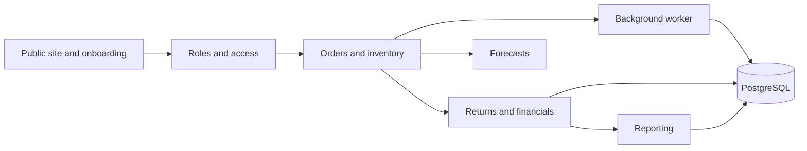

# MEATTRACK project brain

MEATTRACK combines Batangas Premium's public website and business portals in a
single FastAPI application. The UI uses server-rendered Jinja2 and vanilla
JavaScript; PostgreSQL stores business state. The historical repository name
does not describe a current Capacitor application.

This is a map of the local source, initially checked against application/database
revision `5291e25` on 2026-10-28. It is not a production health or deployment record.

## Find the right connection

| Work area              | Read first                           | Connected concerns                                     |
| ---------------------- | ------------------------------------ | ------------------------------------------------------ |
| Application structure  | [[Architecture]]                     | Routes, templates, repositories, worker                |
| Roles or permissions   | [[Roles and Access]]                 | Ownership, capabilities, evidence access               |
| Ordering or stock      | [[Orders and Inventory]]             | Production, FEFO, expiry, transactions                 |
| Returns or money       | [[Returns and Financials]]           | Custody, Sales confirmation, refunds, report snapshots |
| Sales report workspace | [[Sales Activity Reports]]           | Personal actions, snapshots, Owner delivery, exports |
| Messaging or forecasts | [[Background Work and Integrations]] | Durable state, retries, external providers             |
| Schema or deployment   | [[Database and Operations]]          | Baseline, ordered migrations, app and worker           |
| Verification           | [[Testing and Change Impact]]        | Unit, PostgreSQL, browser coverage                     |
| Rationale              | [[Decisions]]                        | Recorded constraints and reasons                       |
| Uncertain information  | [[Questions and Contradictions]]     | Historical docs versus current behavior                |

## Read the graph

Open this project folder as an Obsidian vault. Open **Graph view** to explore
links, or **Backlinks** on a note to see which other areas depend on it. These
notes are ordinary Markdown and can also be read directly by coding agents.
New notes default to `docs/knowledge/`.

## Keep this useful

Read the relevant notes before a substantive change, follow their source links,
and update affected connections afterward. Record uncertain claims explicitly.
Use [[Decisions]] for durable rationale and [[Questions and Contradictions]] for
unresolved discrepancies. Notes are maintained with project work; they are not
an automatic code index or autonomous memory service.

Sources: [Project README](../../README.md), [application factory](../../app/application.py),
[repository agent instructions](../../AGENTS.md).
